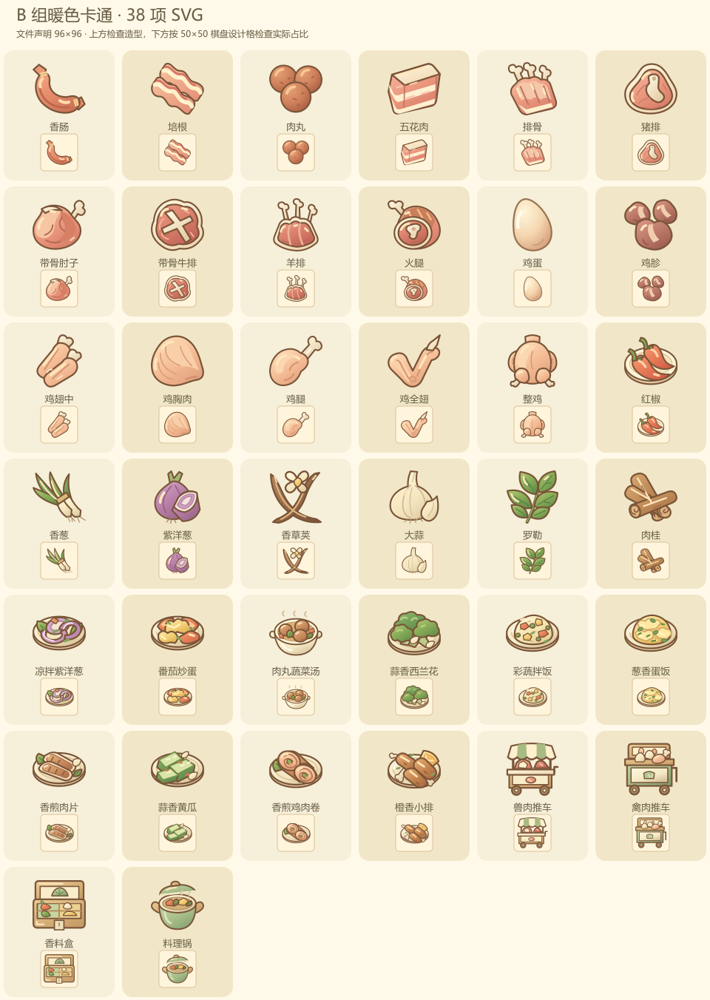

# 鹅巷食光

合成一点食材，煮一碗热乎，把小店慢慢变成喜欢的模样。

移动优先的合成烹饪游戏，保留两个主页面，通过左下角切换美食合成与店铺建设。首段蔬果进度完成后，解锁兽肉、禽肉、调料与家常菜。当前新增的 38 项美术统一为 B 组暖色卡通，SVG 源码和运行文件均声明为 96×96；旧蔬果、人物、界面与街景保留，物品 ID、配方和存档格式延续。

[正式游戏](https://emtismine520.github.io/goose-lane/) · [B 组独立试玩](https://emtismine520.github.io/goose-lane-art-preview/) · [B 组直达入口](https://emtismine520.github.io/goose-lane-art-preview/recover.html)



## 运行与复现

建议 Node.js 22.12+。从干净检出的仓库运行：

```powershell
npm ci --registry=https://registry.npmjs.org
npm run art:build
npm run art:check
npm test
npm run dev
```

正式构建与独立试玩打包：

```powershell
npm run build
npm run package:food-preview
npm run preview
```

`dist/` 可部署到静态 HTTPS 托管；`dist-preview/` 是独立 B 试玩包，不注册离线缓存。两包的 `release.json` 记录同一源码提交。资源路径支持项目子目录；服务器须正确提供 JS、SVG、WebP 与 webmanifest，不能使用双击 HTML 代替 HTTP 服务。

## 怎么玩

1. 点击盘内推车生成食材并消耗体力；相同食材二合，不同食材交换。支持拖拽或先选来源再选目标。
2. 将所需食材投进盘内厨具，选配方开火，完成后领取成品。烹饪时可以继续合成。
3. 订单整单交付，缺料不会扣走其他物品。金币用于店铺建设。
4. 左下角切换店铺与合成页；图鉴、仓库、配方和设置使用弹层。
5. 在图鉴查看食材链与配方；出售可以撤销一次，后续资产变化会结束撤销资格。

规则与进度说明见 [双页规则](docs/TWO_PAGE_RULES.md)。B 试玩摆放全部 34 项新增食材与料理、4 个新增设备，以及旧蔬果和重复食材，供检查美术与真实操作；试玩盘面不代表自然游玩进度。

## 美术

[artwork/b](artwork/b/README.md) 保存 38 项可编辑 SVG 母稿、制作清单与新增 33 项的绘制脚本。五张已认可的 B 样板保留造型、路径、留白和展示偏移。Sharp 0.35.5 固定在锁文件中，生成和检查不依赖私有 PNG 或助手机器目录。

96×96 是文件声明尺寸，棋盘显示框由共享配置单独控制。以 50×50 设计格计，可见主体最长边分别为鸡蛋 34、其他食材 36、料理 38、设备 42。DPR 只调整采样精度，不改变占格大小或指针坐标。来源和哈希见 `public/assets/b-art.json`，详细制作记录见 [素材说明](docs/ASSETS.md)。

A 样板和已替换的新增位图仅保留在本地归档，当前运行包不提供 A。旧风格参数与消息不能切回 A。[试玩说明](docs/FOOD_STYLE_PREVIEW.md)包含本地验收入口。

## 保存、更新与恢复

- 每个成功操作先提交 IndexedDB 事务，再更新界面。写入失败不结算，提供错误和导出入口。
- 当前与上一份快照、旧存档迁移、损坏恢复、JSON 导入导出和三个手动存档位继续保留。
- Web Locks 保证单窗口写入；不支持时，通过同一 IndexedDB 事务内的存档令牌拒绝过期窗口写入。
- 正式游戏首次完整联网加载后可离线使用。新版本等待玩家接受更新，未接受前保持原版本资源一致。
- 旧恢复链接自动进入 B 组独立试玩，无需点击修复，也不等待旧存档或旧离线程序。详见 [PWA 说明](docs/PWA.md)。

## 工程与验证

React 19.2.0、Phaser 4.2.1、TypeScript 5.9.3、Vite 7.1.12；领域命令负责资产结算，React 与 Phaser 共用资源和展示配置。第三方许可见 [声明](docs/THIRD_PARTY_NOTICES.md)，构建会复制到 `dist/notices/`。

本轮 20 个测试文件、209 项自动测试通过；美术检查覆盖 38 项，生产构建遵守 5 MiB 预缓存上限。浏览器尺寸、Canvas/WebGL、DPR 与交互的验收记录见 [B 组交付记录](docs/B_ART_RELEASE.md)。

桌面浏览器、模拟手机尺寸和 HTTP 校验与微信真机分别记录；前者不能标记为微信真机通过。真人上手与长期游玩体验也不能由自动模拟替代。
