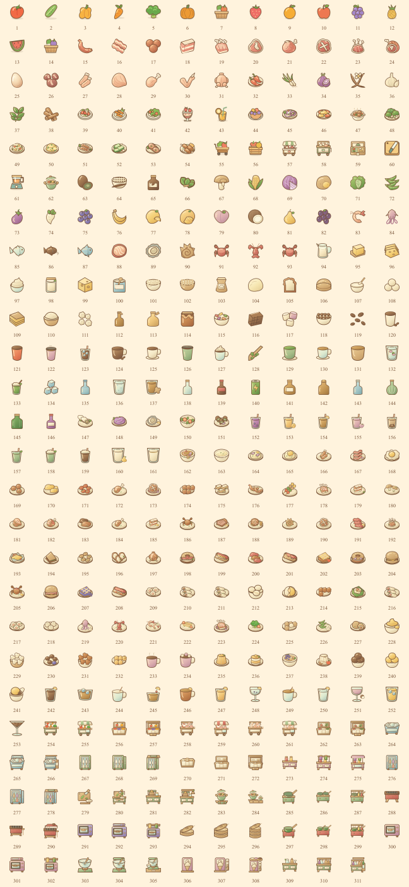

# 鹅巷食光

合成一点食材，煮一碗热乎，把小店慢慢变成喜欢的模样。

移动优先的合成烹饪游戏，保留两个主页面，通过左下角切换美食合成与店铺建设。当前完整图鉴版本3.0.0包含14条合成系列、123道配方、139种成品、22类三级设备和145份主线订单。311个唯一图鉴条目均配有已确认B类暖色卡通资产。设备可合成升级、收纳和移动，旧存档自动迁移至结构3。

[私有试玩](https://goose-lane-table-20261023.leafyscarf257.chatgpt.site) · [完整图鉴与配方](docs/V3_CATALOG.md) · [交付与验证说明](docs/V3_DELIVERY.md)



## 运行与复现

建议 Node.js 22.12+。从干净检出的仓库运行：

```powershell
npm ci --registry=https://registry.npmjs.org
npm run art:build
npm run art:check
npm run art:build:v3
npm run art:check:v3
npm test
npm run simulate:v3
npm run dev
```

正式构建与本地预览：

```powershell
npm run build
npm run preview
```

`dist/` 可部署到静态HTTPS托管，`release.json` 记录构建对应的源码提交。打开 `v3-preview.html` 可选择八个主题检查点、三材料料理样板和三个手机尺寸，使用独立存档。资源路径支持项目子目录；不能使用双击HTML代替HTTP服务。

## 怎么玩

1. 点击盘内推车生成食材并消耗体力；相同食材二合，不同食材交换。支持拖拽或先选来源再选目标。
2. 将所需食材投进盘内厨具，选配方开火，完成后领取成品。烹饪时可以继续合成。
3. 订单整单交付，缺料不会扣走其他物品。金币用于店铺建设和设备副本；两台同类同级设备可合成升级，最高三级。
4. 左下角切换店铺与合成页；图鉴、仓库、配方和设置使用弹层。
5. 在图鉴查看食材链与配方；出售可以撤销一次，后续资产变化会结束撤销资格。

完整图鉴、主题进度、存档迁移和验收边界见 [本版交付](docs/V3_DELIVERY.md)。历史B试玩和原有双页规则继续保留，当前主线以3.0.0为准。

## 美术

[artwork/v3-b](artwork/v3-b/) 保存完整图鉴的B类暖色卡通SVG母稿与绘制模块。[原B素材](artwork/b/README.md)的38项形状、路径、留白和展示偏移保留，新增内容沿同一套风格扩展。Sharp 0.35.5 固定在锁文件中，制作与检查可以从项目源文件复现。

96×96 是文件声明尺寸，棋盘显示框由共享配置单独控制。以 50×50 设计格计，可见主体最长边分别为鸡蛋 34、其他食材 36、料理 38、设备 42。DPR 只调整采样精度，不改变占格大小或指针坐标。来源和哈希见 `public/assets/b-art.json`，详细制作记录见 [素材说明](docs/ASSETS.md)。

A 样板和已替换的新增位图仅保留在本地归档，当前运行包不提供 A。旧风格参数与消息不能切回 A。[试玩说明](docs/FOOD_STYLE_PREVIEW.md)包含本地验收入口。

## 保存、更新与恢复

- 每个成功操作先提交 IndexedDB 事务，再更新界面。写入失败不结算，提供错误和导出入口。
- 当前与上一份快照、旧存档迁移、损坏恢复、JSON 导入导出和三个手动存档位继续保留。
- Web Locks 保证单窗口写入；不支持时，通过同一 IndexedDB 事务内的存档令牌拒绝过期窗口写入。
- 正式游戏首次完整联网加载后可离线使用。新版本等待玩家接受更新，未接受前保持原版本资源一致。
- 旧恢复链接自动进入 B 组独立试玩，无需点击修复，也不等待旧存档或旧离线程序。详见 [PWA 说明](docs/PWA.md)。

## 工程与验证

React 19.2.0、Phaser 4.2.1、TypeScript 5.9.3、Vite 7.1.12；领域命令负责资产结算，React 与 Phaser 共用资源和展示配置。第三方许可见 [声明](docs/THIRD_PARTY_NOTICES.md)，构建会复制到 `dist/notices/`。

本版运行完整测试、311项资产检查及三个种子的完整经营模拟。核心预缓存上限为5 MiB，完整离线资源上限为16 MiB；实际结果与手机尺寸检查见 [交付与验证说明](docs/V3_DELIVERY.md)。[原B组记录](docs/B_ART_RELEASE.md)作为历史证据保留。

桌面浏览器、模拟手机尺寸和 HTTP 校验与微信真机分别记录；前者不能标记为微信真机通过。真人上手与长期游玩体验也不能由自动模拟替代。
